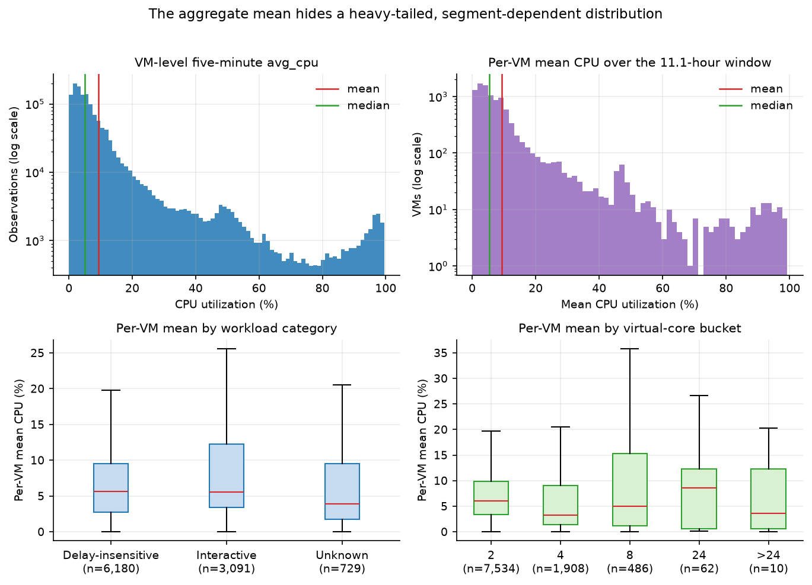
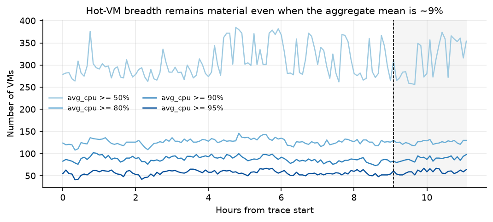
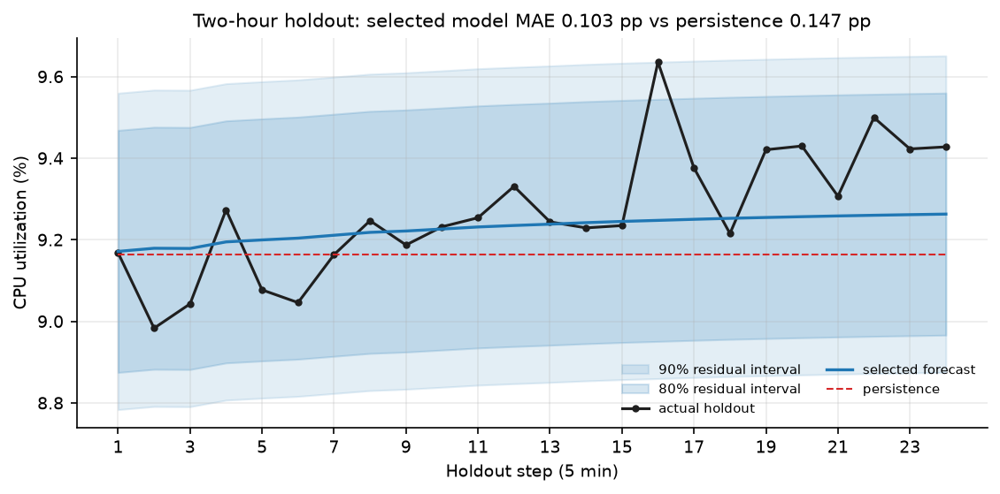

# Cloud Workload Forecasting: Final Report

**Task.** Forecast `active_vm_count` and `aggregate_cpu_utilization` for the final 24 five-minute timestamps of the `data-v1` Azure VM release, fitting and selecting models on the first 110 observations only.

**Executive summary.** `active_vm_count` is exactly 10,000 at every timestamp: all 10,000 VMs have all 134 readings, and every deletion timestamp falls after the window, so persistence is exact. Aggregate CPU is low and smooth (mean 9.39%, range 8.98–9.91%, SD 0.20 pp), but the VM-level distribution is heavy-tailed: the median VM uses about 5% CPU while hundreds exceed 50% and dozens exceed 90% at every timestamp.

I compared 18 candidates—baselines, AR models, ridge, gradient boosting, and equal-weight ensembles—with a four-fold expanding-window backtest. A training-only rule rejected forecasts outside the training range or with materially worse peak error, then chose the lowest mean fold MAE. The winner, `ensemble_p_ar6`, averages persistence and AR(6).

On the frozen holdout, MAE is 0.1026 pp versus 0.1468 for persistence (30.1% lower), RMSE 0.1378 versus 0.1848, and peak MAE 0.2155 versus 0.3085; active count is exact. Cross-validation showed only a 3.8% gain, however, and the ensemble lost to persistence in three of four folds. The holdout's upward drift favoured its AR component, so 30% is one realisation, not a production guarantee.

**Operational recommendation.** Treat the forecast as a two-hour aggregate demand index with a 90% band of about ±0.39 pp, plus a hot-VM guardrail: 73–102 VMs exceeded 90% even while the mean stayed near 9%. In production, replace the constant active count with a churn model and weight CPU by allocated cores.

---

## 1. Data understanding and preprocessing

The release contains 1,340,000 CPU rows (10,000 VMs × 134 observations, 11.1 hours) and 10,000 metadata rows. Timestamps run from 0 to 39,900 seconds in exact 300-second steps, with no gaps, duplicates, or missing/non-finite `avg_cpu`; all rows satisfy `min_cpu <= avg_cpu <= max_cpu` and lie in `[0, 100]`. Metadata covers every VM once. The audit is in [`tables/data_audit.md`](tables/data_audit.md).

`active_vm_count(t)` counts distinct VMs with a valid reading at `t`; `aggregate_cpu_utilization(t)` is the unweighted mean of `avg_cpu` at `t`, in percent. I built the full 134-point series first, then split 110/24: training is 0–32,700, holdout 33,000–39,900. No resampling or filling was used; missing readings would be excluded and audited, but none occurred.

All VMs were created at timestamp 0, and the earliest deletion is at 40,500 seconds, after the window ends at 39,900. This is a complete-trace cohort, not a churning population, so the constant active count is a release artefact, not a forecasting achievement.

## 2. Workload analysis

**Aggregate demand is low and narrow.** Aggregate CPU has mean 9.39%, median 9.37%, SD 0.195 pp, and range 8.98–9.91%. Five-minute changes are usually a few hundredths of a point; the largest holdout jump is about 0.40 pp. The series has slow multi-hour swings rather than a strong trend, so persistence is hard to beat over two hours.

**The VM-level distribution is heavy-tailed and segmented.** Across all readings, `avg_cpu` has mean 9.39%, median 5.11%, p90 19.6%, p99 87.2%, and maximum 99.49%; the per-VM mean has median 5.48% and maximum 99.27% (Figure 1). The distribution combines many lightly used VMs with a persistent high-utilization tail.



*Figure 1. VM-level CPU distribution and segment differences; top panels use log count scales.*

The hot tail is operationally material even when the mean is quiet. At every timestamp, at least 256 VMs exceed 50%, 108 exceed 80%, 73 exceed 90%, and 41 exceed 95%; averages are about 308, 127, 88, and 57, with peaks of 385, 146, 102, and 67 (Figure 2). Watching only the aggregate mean would miss that roughly 1% of the fleet is near saturation.



*Figure 2. Number of VMs above each CPU threshold at each timestamp. The tail persists through the holdout.*

Segment differences reinforce the point. Interactive VMs are 30.9% of the cohort and have per-VM mean CPU 11.49% with p90 27.32%; delay-insensitive VMs are 61.8% with mean 8.24% and p90 14.23%. Interactive and high-utilization VMs therefore deserve separate headroom; an unweighted fleet mean is a demand index, not a capacity measure. Full statistics are in [`tables/segment_stats.md`](tables/segment_stats.md).

**Temporal dependence is short-memory.** Autocorrelation is 0.667 at lag 1, 0.681 at lag 3, 0.367 at lag 12 (one hour), and −0.262 at lag 36 (three hours), with positive values again around lags 72 and 84. Long-lag estimates use few pairs, and an 11.1-hour window cannot identify daily or weekly seasonality. For a two-hour horizon, recent level and short-lag dynamics carry most of the signal; a 4-hour seasonal-naive model risks repeating a level shift.

## 3. Forecasting approach

Both targets use the native five-minute cadence; coarser aggregation would lose resolution without adding information. Persistence is the primary baseline. I also evaluated 6-, 12-, and 24-step moving averages; seasonal naive with 1-, 2-, and 4-hour periods; a 4-hour seasonal random walk blended 50/50 with persistence; simple exponential smoothing; and AR(2)/AR(6) on levels with an intercept. The AR models are estimated by OLS and forecast recursively, with each prediction becoming the newest lag; the intercept lets forecasts mean-revert toward the training level rather than drift.

The ML models are ridge regression (alpha = 10) and a shallow `HistGradientBoostingRegressor` on lags 1, 2, 3, 6, and 12 plus rolling means and standard deviations over 3, 6, and 12 steps. Both are recursive, and features only use values at or before the origin. I did not add calendar features: timestamps are relative to an anonymized trace start, absolute time of day is unknown, and the window is shorter than a day. Ensembles are equal-weight combinations of persistence, the 1-hour mean, AR(6), the 4-hour seasonal naive, and ridge; equal weights avoid fitting a second layer on 96 correlated points. `ensemble_p_ar6` averages persistence and AR(6), keeping a last-value anchor while allowing a modest mean-reverting adjustment.

All hyperparameters were fixed a priori or tuned inside each training window; no holdout value entered fitting, feature selection, or model choice. CPU forecasts are clipped to `[0, 100]`; active-count forecasts are rounded to non-negative integers. Active-count candidates are persistence, 6- and 12-step moving averages, and 1-hour seasonal naive; persistence wins the tie-break.

## 4. Validation methodology

I used an expanding-window, rolling-origin backtest. An origin `o` means the model sees only observations before `o` and is scored on the next 24. With 110 training points, minimum training length 50, horizon 24, and step 12, the origins are 50, 62, 74, and 86. Each model produces 96 out-of-sample predictions; the first fold has 4.2 hours of history and the last 7.2 hours. The final model is refitted on all 110 training observations and forecasts the 24 holdout timestamps.

This mirrors production: at each decision point, the forecaster stands at the end of the available history and predicts the next two hours. There is no random shuffling. Validation windows overlap by 12 observations, so the 96 points are not independent; I report pooled and per-fold metrics.

I report MAE and RMSE in percentage points, sMAPE, MASE, normalized MAE relative to persistence, peak-period MAE (top quartile of actuals), calm-period MAE, and bias. sMAPE uses `max(|y| + |ŷ|, 10⁻⁸)` as its denominator; the guard is inactive here because the target is around 9%, but it prevents instability near zero.

The selection rule was fixed before looking at the holdout: (1) results on all four folds; (2) no forecast outside the observed training range; (3) pooled peak-period MAE at most 10% worse than persistence; (4) worst-fold MAE at most 10% worse than persistence's worst fold; (5) lowest mean fold MAE, with persistence preferred on ties. The range and peak checks are risk controls, not significance tests; the top candidates were close enough that the ranking is a preference, not a decisive ordering.

Prediction intervals use the selected model's 96 cross-validation residuals: the 80% and 90% two-sided bands are the empirical 0.80 and 0.90 quantiles of absolute error, 0.2968 pp and 0.3880 pp. These are empirical, dependent-residual summaries, not formal guarantees; they were frozen before holdout scoring and then checked for coverage.

## 5. Results versus baseline

Table 1 summarizes the leading candidates. The selected ensemble has the lowest mean fold MAE (0.1977), just ahead of the seasonal random walk (0.1989) and the four-component ensemble (0.1993); the top three are within 0.0016 pp. Its pooled CV MAE is 0.1977 versus 0.2056 for persistence (3.8% lower), while its pooled peak MAE is slightly worse (0.2631 versus 0.2591) but inside the 10% gate. The seasonal random walk has lower peak and worst-fold MAE, so accuracy and risk criteria rank candidates differently.

| Model | Family | Mean fold MAE | Worst fold MAE | Pooled MAE | Peak MAE | Eligible |
|---|---|---:|---:|---:|---:|---|
| `ensemble_p_ar6` | ensemble | 0.1977 | 0.2834 | 0.1977 | 0.2631 | yes |
| `seasonal_random_walk_48` | baseline | 0.1989 | 0.2708 | 0.1989 | 0.2570 | yes |
| `ensemble_p_ma12_ar6_s48` | ensemble | 0.1993 | 0.2840 | 0.1993 | 0.2777 | yes |
| `ensemble_p_ma12_s48` | ensemble | 0.2008 | 0.2796 | 0.2008 | 0.2733 | yes |
| `persistence` | baseline | 0.2056 | 0.2975 | 0.2056 | 0.2591 | yes |

*Table 1. Leading models by mean fold MAE; full table in [`tables/model_comparison.md`](tables/model_comparison.md).*

Table 2 shows fold-level instability: the ensemble is worse than persistence in folds 0, 2, and 3 (by 5.7%, 23.4%, and 19.4%) and better in fold 1 by 34.2%. Its mean fold MAE wins on the large fold-1 gain, but mean per-fold normalized MAE is 1.036, slightly worse than persistence on a typical fold; the criterion rewards average accuracy, not uniform dominance.

| Fold | Training n | Persistence MAE | Selected MAE | Relative change |
|---|---:|---:|---:|---:|
| 0 | 50 | 0.2681 | 0.2834 | +5.7% |
| 1 | 62 | 0.2975 | 0.1956 | −34.2% |
| 2 | 74 | 0.1245 | 0.1536 | +23.4% |
| 3 | 86 | 0.1324 | 0.1582 | +19.4% |
| Mean | — | 0.2056 | 0.1977 | −3.8% |

*Table 2. Per-fold MAE on the expanding-window backtest. Positive relative change means the selected model is worse than persistence.*

On the frozen holdout (Table 3), MAE is 0.1026 versus 0.1468 pp (30.1% lower), RMSE 0.1378 versus 0.1848 (25.4% lower), and peak MAE 0.2155 versus 0.3085; sMAPE, MASE, calm MAE, and bias also improve. Figure 3 shows the forecast and bands.



*Figure 3. Frozen holdout forecast for aggregate CPU. Shading shows the 80% and 90% empirical residual bands; the dashed line is persistence.*

| Metric | Selected | Persistence | Improvement |
|---|---:|---:|---:|
| MAE (pp) | 0.1026 | 0.1468 | 30.1% |
| RMSE (pp) | 0.1378 | 0.1848 | 25.4% |
| sMAPE (%) | 1.1048 | 1.5851 | 30.3% |
| MASE | 0.8469 | 1.2119 | 30.1% |
| Normalized MAE | 0.6988 | 1.0000 | 30.1% |
| Peak MAE (pp) | 0.2155 | 0.3085 | 30.1% |

*Table 3. Holdout metrics. Peak periods are the top quartile of holdout actuals.*

The holdout gain exceeds the CV gain because actuals drift from 9.17 to 9.43 while the last training value is 9.16. Persistence under-predicts; the AR component mean-reverts upward and matches this window. This is a favourable realisation, not a stable 30% gain; 3.8% is the conservative number.

The active-count forecast is exactly 10,000 for all 24 timestamps (MAE 0); persistence won the tie-break. Both the 80% and 90% bands contain 23 of 24 holdout points (95.8%). The miss is the step-16 spike (error 0.38809 versus the 90% margin 0.38799, a 0.0001 pp breach). The 80% band also contains 23 because no other error lies between 0.2968 and 0.3880. These bands are guides, not guarantees.

## 6. Error and failure analysis

The selected model is slightly worse than persistence at steps 1–6 (MAE 0.1157 versus 0.1034) because the AR component pulls upward while early actuals dip. It is better at 7–12 (0.0391 versus 0.0717), 13–18 (0.0967 versus 0.1583), and 19–24 (0.1589 versus 0.2537); the advantage grows with horizon in this holdout, not by construction.

The dominant failure is the step-16 spike: actual 9.636, forecast 9.248, error +0.388 pp. Persistence is also wrong (constant 9.165, error 0.471), so the ensemble halves the miss but cannot anticipate it. The spike is a one-step burst with no precursor in the univariate history; aggregate CPU alone cannot reveal an exogenous event. The band misses by a hair, consistent with an outlier rather than a regime change.

The second failure is level-shift direction. In fold 1 the series shifted down and mean reversion helped, beating persistence by 34%. In folds 2 and 3 the series drifted up and persistence won because AR pulled toward the training mean. This is the bias–variance trade-off of mean reversion: it helps when the last value is an outlier and hurts when the level is trending. Fold 0, with only 50 points, is the ensemble's worst (0.2834), unsurprising given noisy AR(6) estimates.

The aggregate metric also hides the hot-tail failure mode: low fleet-mean MAE can coexist with saturated VMs. Here hot-VM counts stay in the training range, so an operator watching only the mean would miss the difference between quiet and busy tails. This motivates the two-tier recommendation. Active count has no failure to analyse because it is constant—a cohort property, not a modelling achievement.

## 7. Capacity-planning recommendation

The forecast is a two-hour demand index, not a direct cluster-capacity number. `aggregate_cpu_utilization` is an unweighted mean of per-VM percentages; map it to a core-weighted or host-weighted measure before provisioning. With that caveat:

1. **Aggregate headroom.** Provision point forecast + 90% margin (~0.39 pp, ~4% of the current 9.4% level). If the upper band crosses capacity, pre-warm or scale before the window.
2. **Hot-tail guardrail.** Track VMs above 90%/95% (means 88/57; maxima 102/67). Trigger per-VM or segment remediation when counts exceed their recent range or interactive p90 rises. A 9% fleet mean does not mean a healthy fleet.
3. **Peak-risk trigger.** If the forecast or upper band rises faster than the recent baseline (e.g. >0.2 pp over a few steps), pre-warm the interactive pool. This shortens reaction time but cannot predict the step-16 spike.
4. **Active-count treatment.** Hold at 10,000 here. In production, use an arrival/churn model and recompute aggregate CPU on the forecast population.

The trade-off is asymmetric: aggregate headroom is cheap because the level is low and the band is narrow, while an SLO breach or noisy-neighbour incident is costly. Blanket over-provisioning nonetheless wastes capacity because the median VM uses about 5% CPU. The efficient policy is targeted—aggregate headroom plus hot-tail and interactive-segment headroom—with thresholds calibrated to SLOs and cost.

## 8. Limitations and future work

The main limitation is sample size: 110 training observations (9.2 hours), a 24-point holdout, and at most 86 points of validation history. This is enough for simple models but not to estimate daily or weekly seasonality or to separate candidates whose mean fold MAEs differ by 0.002 pp; the top three were within 0.0016 pp.

Validation and holdout disagree in magnitude: CV showed a 3.8% gain and a slight peak-MAE regression, while the holdout showed 30% because of upward drift. One realisation cannot establish a stable advantage; production evaluation should use multiple rolling holdouts, blocked cross-validation, and fold-level relative performance, not only a worst-fold cap.

The univariate target ignores segment mix, churn, host contention, exogenous events, and calendar effects; active count is a release artefact, and the mean is not a capacity measure. The intervals are dependent, not formal guarantees: both bands covered 23 points, and the miss was a spike just beyond the 90% margin. Future work should add segment reconciliation, a core-weighted target, churn and event features, blocked conformal calibration, changepoint detection, and a fold-level robust selection rule.

## Appendix: reproduction and detailed tables

From a clean checkout, install the package and development dependencies, extract the fixed `data-v1` release into `challenge_data/`, and run:

```bash
python -m cwfc.predict --data challenge_data --output predictions.csv --manifest reports/run_manifest.json
```

This writes the 24-row `predictions.csv` without using holdout target values (`include_holdout=False`). To regenerate the analysis:

```bash
python -m cwfc.analyze --data challenge_data --reports-dir reports
```

To run tests:

```bash
python -m pytest -q
```

The file has exactly the required columns, 24 chronological timestamps (33,000–39,900), finite values, `active_vm_count = 10000`, and CPU values in `[0, 100]`. The manifest records the selected model, origins, data hashes, and interval margins. Full artefacts are in `reports/`.

- Data audit: [`tables/data_audit.md`](tables/data_audit.md)
- Target statistics: [`tables/target_stats.md`](tables/target_stats.md)
- Segment statistics: [`tables/segment_stats.md`](tables/segment_stats.md)
- Hotspot summary: [`tables/hotspot_summary.md`](tables/hotspot_summary.md)
- Full model comparison: [`tables/model_comparison.md`](tables/model_comparison.md)
- Holdout metrics: [`tables/holdout_metrics.md`](tables/holdout_metrics.md)
- Per-step holdout errors: [`tables/error_by_horizon.md`](tables/error_by_horizon.md)
- Machine-readable results: [`results.json`](results.json)
